# NextBill

반복 결제(구독·통신비·보험 등)를 등록하면 다음 결제일, 이번 달 합계, 결제 전 알림, 위젯, 캘린더를 보여 주는 오프라인 Android 앱입니다. 서버도 계정도 없고, 모든 데이터는 기기 안에만 있습니다.

> **English summary.** NextBill is an offline Android app (Kotlin, Jetpack Compose, multi-module in the style of Now in Android) that tracks recurring payments and reminds you before each charge.
> The design spec, implementation plan and ADRs were written and adversarially reviewed before any code; the commit history shows docs first.
> Domain rules are pure, table-tested functions; side effects (Room, DataStore, alarms, notifications, widget) sit behind interfaces, with a single inexact OS alarm for all reminders.

| 홈 | 홈(다크) | 캘린더 | 상세 | 등록·수정 | 설정 | 알림 |
|---|---|---|---|---|---|---|
| 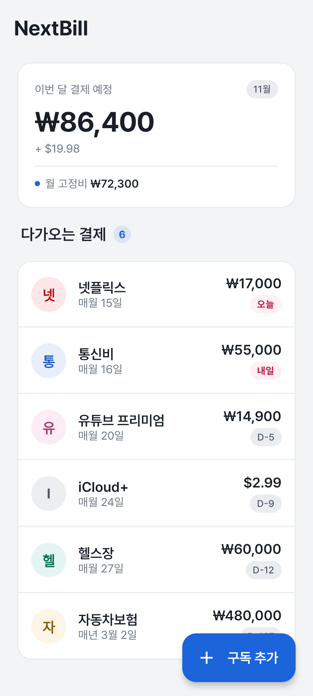 | 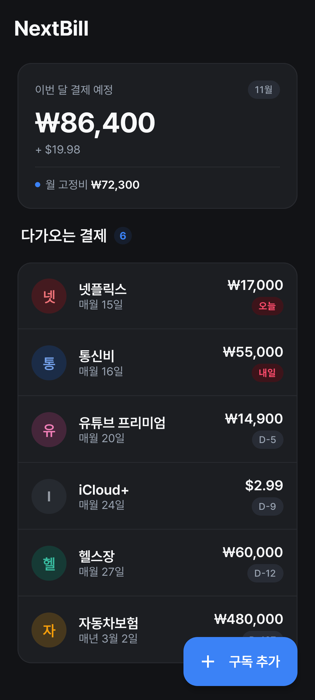 | 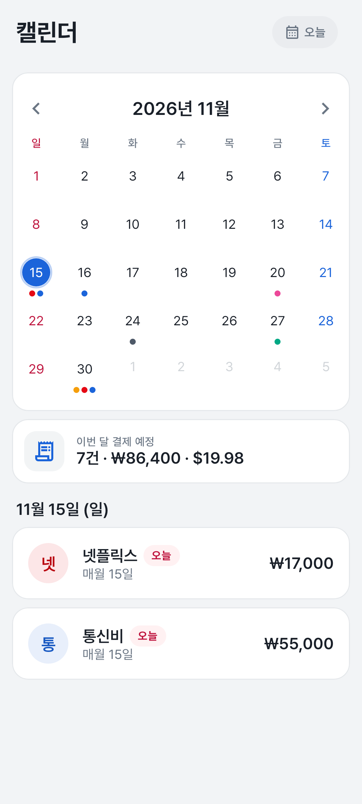 | 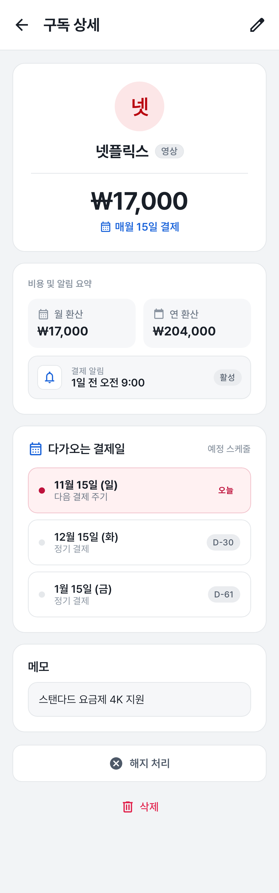 | 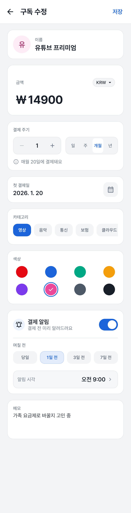 | 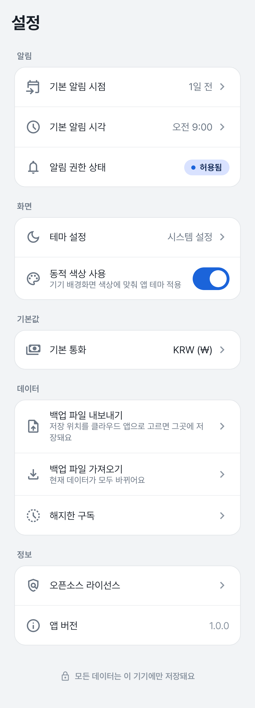 | 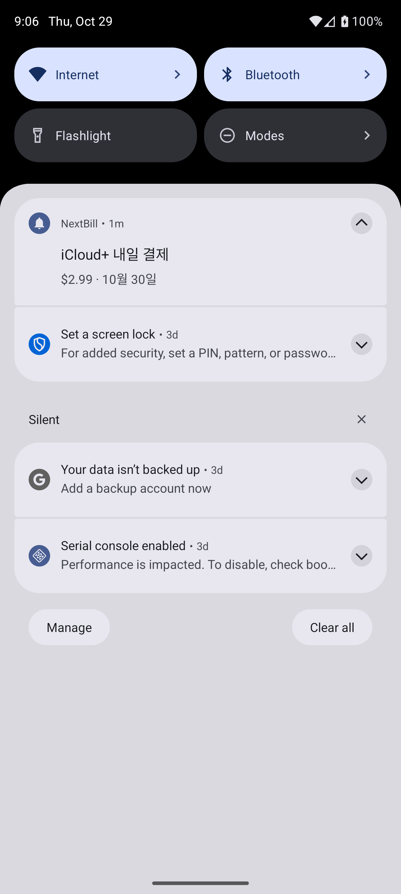 |

알림 화면은 API 36 에뮬레이터에서 찍었고, 나머지는 Roborazzi 기준 이미지(Robolectric, 360dp)입니다. 위젯 실제 화면: [`docs/design/widget-actual.png`](docs/design/widget-actual.png)

## 1. 설계 먼저

코드보다 문서가 먼저 있습니다.

- 설계 문서: [`docs/superpowers/specs/2026-10-23-nextbill-design.md`](docs/superpowers/specs/2026-10-23-nextbill-design.md)
- 구현 계획서(태스크 25개, 커밋 지점 11개): [`docs/superpowers/plans/2026-10-24-nextbill-v1.md`](docs/superpowers/plans/2026-10-24-nextbill-v1.md)
- 결정 기록 14개: [`docs/adr/`](docs/adr/) (맥락 → 결정 → 대안 → 결과)
- 디자인 원본(Google Stitch): [`docs/design/stitch/`](docs/design/stitch/)
- Codex 적대적 리뷰 5회와 판정 대응표: [`docs/reviews/`](docs/reviews/)

`git log --reverse --oneline | head -8` 결과입니다. 앱 코드는 아홉 번째 이후 커밋부터 들어갑니다.

```
5fc14af Add NextBill v1 design spec and Stitch prompts
f5112b4 Add Google Stitch design export
655c8fc Add calendar tab and record Stitch review decisions
3ac44bc Add second-round Stitch revision prompts
fa44c24 Replace Stitch export with second-round revision
253fc1f Add NextBill v1 implementation plan
b9c8e30 Use dev.lioracode.nextbill as the package root
343e1a6 Address adversarial review: active periods, occurrence-bound reminders, recoverable import, device-only backup
```

## 2. 아키텍처

`settings.gradle.kts`의 모듈과 실제 `build.gradle.kts` 의존을 그대로 옮긴 그림입니다. feature `impl`은 convention plugin이 `core:domain`·`core:designsystem`·`core:ui`·`core:navigation`을 함께 붙입니다(그림에서는 생략).

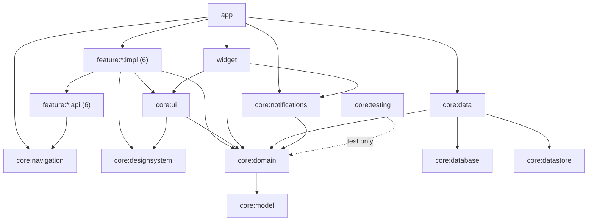

**의존 규칙** (설계 문서 §5.2, `./gradlew checkModuleRules`가 강제)

1. `core:model`은 프로젝트 의존 0개, `core:domain`은 `core:model`만 의존합니다. 둘 다 Android 의존성이 없는 JVM 모듈입니다.
2. `feature:*:impl`은 다른 feature의 `impl`을 의존하지 않고, 화면 이동은 상대의 `api`(NavKey)로만 합니다.
3. `core:database`·`core:datastore`는 `core:data`만 의존할 수 있습니다.
4. `feature:*`는 `core:data`를 의존하지 않습니다(조립은 `app`).

검사 범위: 프로젝트 간 의존만 봅니다. 외부 라이브러리와 테스트 설정(`test*`, `androidTest*`, `*UnitTest*`, `*AndroidTest*`)은 보지 않습니다. 외부 라이브러리는 카탈로그와 `licenses.json` 검사로 다룹니다. `feature:home:impl`에 `compileOnly(projects.core.data)`를 넣으면 실패하는 것을 Task 18에서 확인했습니다.

## 3. Now in Android와 다른 점

기준은 NiA 커밋 `2982e63`입니다. 자세한 근거는 [ADR-0011](docs/adr/0011-differences-from-nia.md)에 있습니다.

| 항목 | NiA | NextBill | 이유 |
|---|---|---|---|
| 네트워크·동기화 | Retrofit, WorkManager 동기화 | 없음 | 오프라인 앱(ADR-0001) |
| 설정 저장 | Proto DataStore + protobuf 플러그인 | Preferences DataStore | 키 7개뿐. protobuf 플러그인을 들일 이유가 없음 |
| minSdk | 24 + desugaring | 26, desugaring 없음 | `java.time`을 desugaring 없이 쓰기 위해(ADR-0002) |
| 오늘 날짜 | — | `CurrentDateSource`(날짜 변경 브로드캐스트·자정 코루틴) | 켜 둔 화면의 날짜·D-n이 자정에 바뀌도록(ADR-0012) |
| 알람 | — | 앱 전체에 비정확 알람 1개 | 앱당 알람 500개 한도(ADR-0003) |
| 백업 | 기본 | 클라우드 백업 끔, 기기 간 전송만 | ADR-0008 |
| CI | GitHub Actions | 없음, 커밋 지점마다 로컬 전체 검사 | 1인 저장소에서 main에 직접 커밋 |

**모듈 수에 대해:** 1인 앱에 모듈 24개는 많습니다. 빌드가 빨라지거나 팀이 나눠 일하는 이점은 이 앱에서 거의 없습니다. 그래도 나눈 이유는 의존 방향을 컴파일러와 `checkModuleRules`가 막게 하려는 것입니다. 도메인 규칙이 Android 없이 JVM 테스트로 돌고, 화면이 저장소 구현을 모르는 구조가 문서가 아니라 빌드로 지켜집니다.

## 4. 도메인 설계 사례

### 사용 구간(해지·복원)

구독은 상태 플래그 대신 사용 구간 목록을 가집니다. 해지한 동안의 결제가 지난달 캘린더나 합계에 다시 생기지 않고, 같은 날 해지·복원해도 결제가 두 번 세어지지 않습니다.

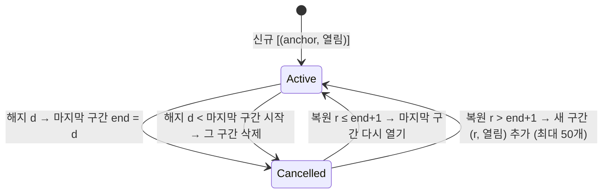

### 알림: occurrence 기록과 reconcile, OS 알람 하나

구독마다 "다음 결제일에 대한 알림"(occurrence)을 DB에 기록하고, OS에는 그중 가장 이른 시각의 비정확 알람 하나만 겁니다. 갱신은 전부 취소하지 않고 바뀐 구독의 기록만 고칩니다(reconcile). 그래서 Doze로 늦어지는 중인 다른 구독의 알림이 사라지지 않습니다.

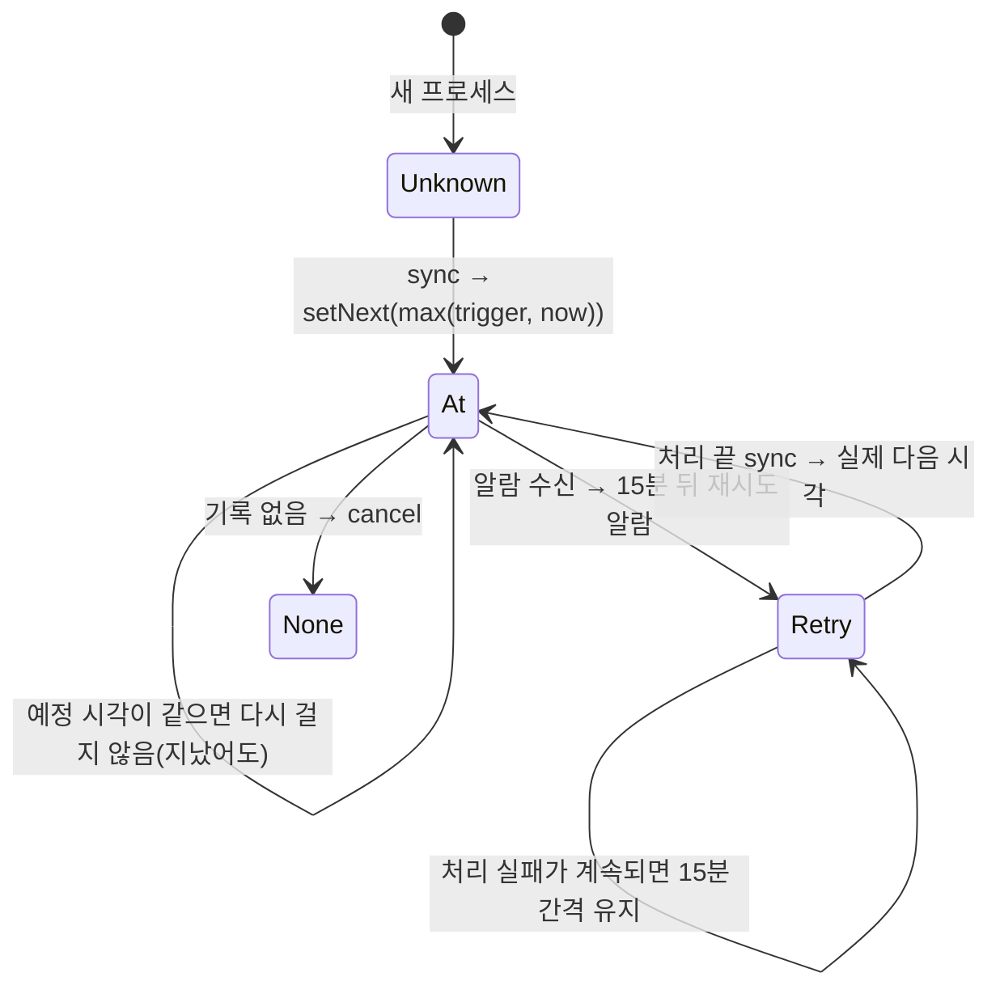

화면에 남은 알림과 새 알림을 합쳐 4건 이상이면 묶음 알림 하나로 보여 줍니다. 그래서 앱 알림은 화면에 항상 3개 이하입니다(Android의 앱당 알림 50개 한도). 전달은 best effort입니다(ADR-0014).

### 저장과 파생 상태 분리, 가져오기 관문

저장은 DB에 반영되면 성공입니다. 알림·위젯 갱신은 앱 범위에서 따로 돌고, 실패해도 저장 결과를 바꾸지 않습니다(ADR-0013). 백업 가져오기는 임시 파일(journal)에 먼저 쓰고 적용하며, 모든 쓰기는 잠금을 얻은 뒤 "준비 상태"와 "데이터 세대"를 다시 확인합니다. 세대는 Room에 영속 저장해, 프로세스가 다시 만들어져도 가져오기 전에 연 화면의 저장을 막습니다(ADR-0007).

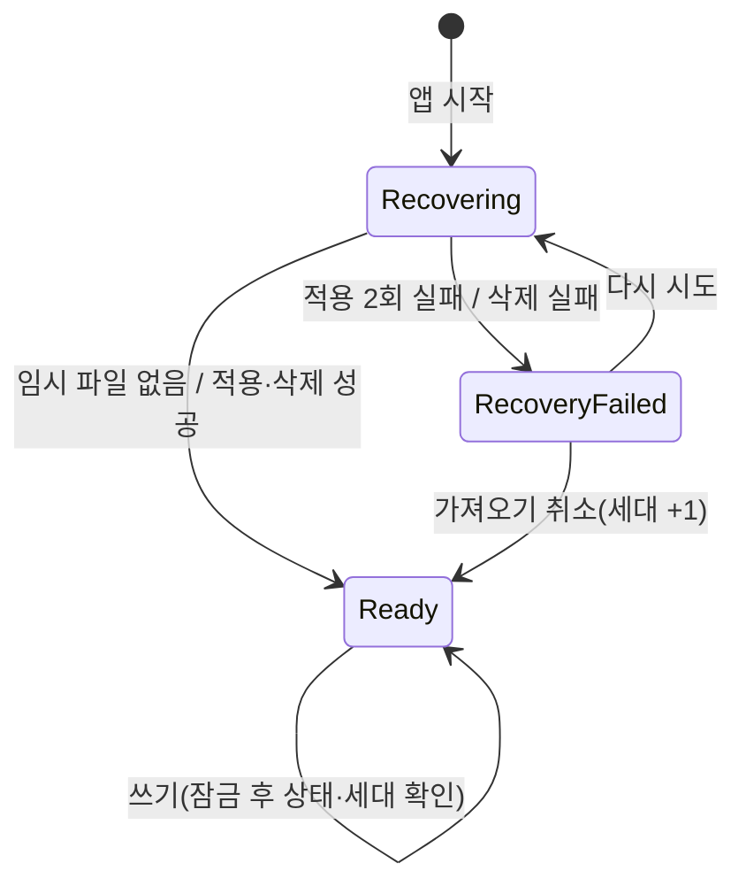

## 5. 객체지향과 함수형의 분배, 성능에 대한 설계 의도

| 영역 | 방식 |
|---|---|
| 도메인 규칙(결제일, 합계, 환산) | 함수형: 부수효과 없는 최상위 함수, 불변 입력·출력, 결제일은 `Sequence`로 지연 생성 |
| 경계(저장, 알림, 위젯, 시간) | 객체지향: 인터페이스 + 구현, Hilt 조립 |
| 화면 상태 | 함수형: Room `Flow` + 오늘 날짜 `Flow` → `combine` → 불변 `UiState` |
| 사용자 액션 | ViewModel 메서드 → UseCase, 결과는 직접 정의한 sealed 타입 |

**MVI가 아니라 MVVM + 단방향 데이터 흐름(UDF)을 고른 이유**

Compose에 필요한 것은 패턴 이름보다 세 가지입니다. 화면 상태가 불변 객체 하나일 것, 상태는 아래로·사용자 행동은 위로만 흐를 것, 화면은 상태를 받아 그리기만 할 것. NextBill은 이 셋을 지킵니다. 화면마다 `StateFlow<UiState>`를 내보내고(알림 권한을 묻는 편집·상세·설정 화면은 "이미 물어봤는지" `StateFlow<Boolean>`을 하나 더 받습니다), 화면 단계는 sealed 타입(예: `EditorPhase`의 Editing·AskingPermission·Saving·Saved·Missing)으로 나타내며, 저장 완료처럼 한 번만 일어나는 결과도 Channel 이벤트가 아니라 상태로 표현합니다.

MVI는 여기에 sealed `Intent` 하나와 `reduce(state, intent)`를 더합니다. 상태 변경 경로가 많은 화면에서는 이 두 가지가 변경을 한곳에 모아 줍니다. NextBill의 상태 변경은 대부분 UseCase → Room `Flow` → `combine`을 거쳐 들어오므로 리듀서에 남는 로직이 적습니다. 화면 6개 규모에서는 Intent 타입과 분기 코드만 늘어난다고 판단해 의도별 메서드(`onSaveClick`, `onReminderSwitch` 등)를 두었습니다. 한 화면에서 상태 변경 경로가 크게 늘면 그 화면부터 sealed `Action` + `onAction()`으로 바꾸는 것이 다음 단계입니다.

성능 개선 수치는 측정하지 않았으므로 쓰지 않습니다. 설계에서 의도한 것은 두 가지입니다. 계산은 `@DefaultDispatcher`에서 하고, 목록은 지연 그리기(`LazyColumn` `items` + key)로 그립니다. 구독 한도는 1,000건입니다.

Compose 컴파일러 리포트(`./gradlew assembleRelease -PcomposeReports=true`)에서 확인한 것:

- `CalendarPayment`: **stable(컴파일러 추론)**. 필드가 모두 `compose_compiler_config.conf`에 선언한 타입이거나 기본 타입입니다.
- `UpcomingItem`: 처음에는 `DueLabel` 때문에 `Uncertain`이었습니다. `DueLabel`은 객체 2개와 `Int` 하나를 가진 data class뿐인 불변 타입이라 `compose_compiler_config.conf`에 근거와 함께 추가했고, 그 뒤 **stable(설정 파일로 선언)**이 됐습니다.
- `HomeUiState.Ready`: **unstable**. `AmountSummary`(`List<Money>`를 가짐)와 `List<UpcomingItem>` 때문입니다. `List`를 담는 타입은 설정 파일에 넣지 않는다는 규칙대로 그대로 두었습니다. `@Stable`·`@Immutable`은 리포트를 통과시키려고 붙이지 않습니다.

## 6. 데이터 원칙

- 서버·네트워크가 없습니다. `INTERNET` 권한이 없습니다(release APK의 `aapt2 dump permissions`로 확인).
- 클라우드 자동 백업은 끕니다. 기기를 바꿀 때의 기기 간 전송만 DB와 설정 파일을 옮깁니다(ADR-0008).
- 사용자가 직접 내보낸 백업 파일은 사용자가 고른 위치에 저장됩니다. 클라우드 앱을 고르면 그곳에 저장됩니다.

## 7. 라이브러리

| 쓴 것 | 용도 |
|---|---|
| Kotlin 2.4.21 (AGP 9.4.1 내장), KSP 2.3.12, Hilt 2.60.1 | 언어, 코드 생성, DI |
| Jetpack Compose (BOM 2026.09.00) + Material 3 | 화면 |
| Navigation 3 1.2.0, Lifecycle 2.11.0 | 화면 이동, ViewModel |
| Room 2.8.5, Preferences DataStore 1.3.0 | 저장 |
| Glance 1.2.0 | 홈 화면 위젯 |
| kotlinx-serialization, kotlinx-coroutines | 백업 JSON, 비동기 |
| JUnit4, Truth, Turbine, Robolectric 4.17, Roborazzi 1.77.0 | 테스트 |
| Pretendard 1.3.9(OFL), Material Symbols(Apache-2.0) | 글꼴, 아이콘 |

**넣지 않은 것:** Retrofit·OkHttp(네트워크 없음), Coil·이미지·차트 라이브러리(화면에 필요 없음), Firebase(서버·분석 없음), kotlinx-datetime·desugaring(minSdk 26의 `java.time`), WorkManager 직접 사용(알람 하나로 충분, Glance가 내부적으로 쓰는 것은 허용 — ADR-0006), Timber, accompanist, protobuf 직접 사용(Preferences DataStore). 앱에 들어가는 라이브러리 전체와 라이선스는 앱의 "오픈소스 라이선스" 화면에 있습니다(`releaseRuntimeClasspath` 기준, ADR-0010).

## 8. AI와 어떻게 일했나

- **규칙 문서:** [`CLAUDE.md`](CLAUDE.md)에 모듈 규칙, 금액·시간 규칙, 커밋 규칙을 검증할 수 있는 문장으로 적었습니다.
- **hook:** `.kt`/`.kts`를 고치면 그 파일만 `spotlessApply`, 작업이 끝나면 바뀐 모듈의 테스트(`scripts/test-changed.sh`).
- **계획서 단위 진행:** 태스크마다 구현 에이전트가 TDD로 구현하고, 다른 에이전트가 계획서·설계 문서와 대조해 검토했습니다. 검토 지적은 수정 → 범위를 좁힌 재검토로 닫았고, 계획서와 다르게 정한 것은 커밋 본문과 ADR에 남겼습니다.
- **적대적 리뷰:** 구현 전에 Codex가 설계 문서와 계획서를 5회 반례 중심으로 검토했고, 지적마다 원문·AOSP 소스와 대조한 판정을 [`docs/reviews/2026-10-24-review-response.md`](docs/reviews/2026-10-24-review-response.md)에 남겼습니다.
- **사람의 역할:** 범위·우선순위 결정과 리뷰는 Alex가 하고, 커밋은 계획서의 커밋 지점에서만 논리 단위로 합니다.

## 9. 빌드와 테스트

JDK 17, Android SDK(compileSdk 37)가 필요합니다.

```bash
./gradlew assembleDebug                       # 빌드
./gradlew -p build-logic test                 # convention plugin·모듈 규칙 테스트
./gradlew spotlessCheck checkModuleRules lintDebug
./gradlew testDebugUnitTest :core:model:test :core:domain:test :core:testing:test
./gradlew verifyRoborazziDebug                # 스크린샷 비교 (기준 이미지는 recordRoborazziDebug)
```

**QA 결과:** 단위 테스트 612개(Robolectric 포함) + build-logic 테스트 16개, 실패 0. 위 전체 명령을 `clean`부터 로컬에서 실행해 `BUILD SUCCESSFUL`을 확인했습니다(2026-10-26). 에뮬레이터 직접 확인과 확인하지 못한 항목은 [`docs/qa/v1-checklist.md`](docs/qa/v1-checklist.md)에 있습니다.

## 라이선스

앱 코드의 라이선스는 아직 정하지 않았습니다. 포함된 글꼴·아이콘·라이브러리의 라이선스는 앱의 오픈소스 라이선스 화면과 `core/designsystem/LICENSE-Pretendard.txt`에 있습니다.
